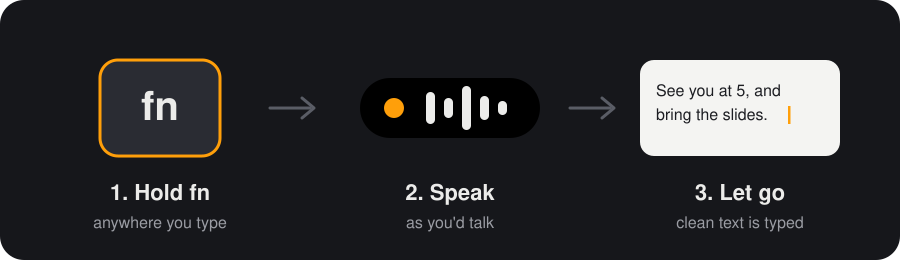
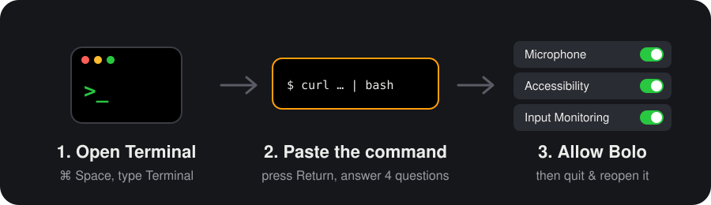
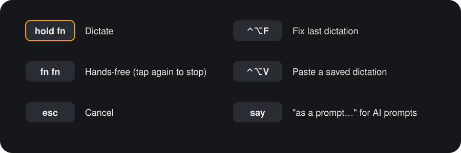

<p align="center">
  
</p>

<h1 align="center">Bolo</h1>

<p align="center">
  <b>Hold a key, speak, let go. Your words are typed for you.</b><br>
  Free dictation for Apple Silicon Macs. Works in any app, even offline.
</p>

<p align="center">
  
</p>

## Install

<p align="center">
  
</p>

Paste this into **Terminal** and press Return:

```bash
curl -fsSL https://raw.githubusercontent.com/soumyaux/bolo/main/install.sh | bash
```

Press Return to accept each suggested answer. A Groq key is optional: skip it to stay offline.

Then allow Bolo in **System Settings › Privacy & Security**, quit it from the 🎙 menu, and open it again.

**You need:** a Mac with Apple Silicon (M1 or newer), macOS 13 or newer, and 4 GB of free space.

## Use

<p align="center">
  
</p>

## Good to know

- 🔒 **Private.** Without a Groq key, your voice never leaves your Mac.
- 🔄 **Updates.** The 🎙 menu tells you when a new version is out. One click installs it.
- 🗑 **Uninstall:** `curl -fsSL https://raw.githubusercontent.com/soumyaux/bolo/main/uninstall.sh | bash`

**Something not working?** See the [full guide](docs/GUIDE.md#troubleshooting) or [open an issue](https://github.com/soumyaux/bolo/issues/new/choose).

[Full guide](docs/GUIDE.md) · [How it works](docs/HOW-IT-WORKS.md) · [Contributing](CONTRIBUTING.md) · [MIT License](LICENSE)
