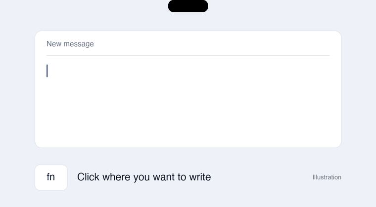
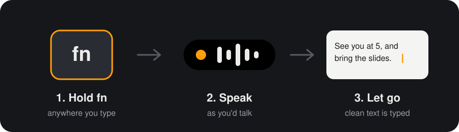
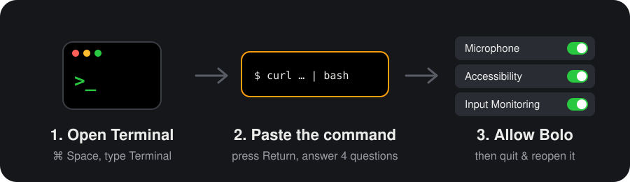
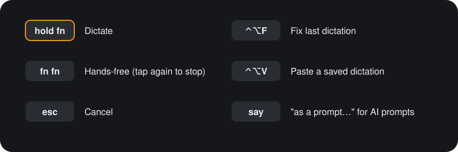

<p align="center">
  
</p>

<h1 align="center">Bolo</h1>

<p align="center">
  <b>Hold a key, speak, let go. Your words are typed for you.</b><br>
  Free dictation for Apple Silicon Macs. Works in any app, even offline.
</p>

<p align="center">
  
</p>

<p align="center">
  
</p>

## Install

<p align="center">
  
</p>

Paste this into **Terminal** and press Return:

```bash
curl -fsSL https://raw.githubusercontent.com/soumyaux/bolo/main/install.sh | bash
```

Press Return to accept each suggested answer. A Groq key is optional: skip it to stay offline.

Then allow Bolo in **System Settings › Privacy & Security**, quit it from the **b** menu, and open it again.

**You need:**

- A Mac with Apple Silicon (M1 or newer). Intel Macs are not supported.
- macOS 13 or newer.
- About 2 GB of free space, or 5 GB with the optional AI cleanup.
- 8 GB of memory works. The installer suggests skipping AI cleanup on these Macs, and dictation works without it.

## Local or Groq

Bolo is free either way. Local is the default if you skip the key.

| | Local | Groq (your own free key) |
| --- | --- | --- |
| Where speech is processed | On your Mac | Sent to Groq |
| Works offline | Yes | Falls back to Local |
| Typical wait after speaking | 0.8 s | 0.4 s |
| Word error rate | 21.2% | 20.6% |
| Limits | None | Groq's free daily limit, then Local |

Measured on 17 real dictations by one speaker, on one Mac, so treat the numbers as a rough guide. The accuracy difference is too small to matter.

## Use

<p align="center">
  
</p>

## Good to know

- 🔒 **Private.** Without a Groq key, your voice never leaves your Mac.
- 🔄 **Updates.** The **b** menu tells you when a new version is out. One click installs it.
- 🗑 **Uninstall:** `curl -fsSL https://raw.githubusercontent.com/soumyaux/bolo/main/uninstall.sh | bash`

**Something not working?** See the [full guide](docs/GUIDE.md#troubleshooting) or [open an issue](https://github.com/soumyaux/bolo/issues/new/choose).

[Full guide](docs/GUIDE.md) · [How it works](docs/HOW-IT-WORKS.md) · [Contributing](CONTRIBUTING.md) · [MIT License](LICENSE)
